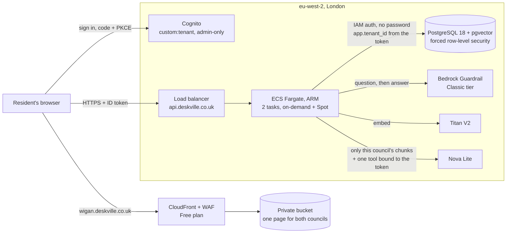

# Deskville: case study

**One platform, many towns, and not a single byte allowed to cross between them.** Two councils, Wigan and Bury, share every piece of infrastructure: one database, one search index, one API, one model, one website distribution. This document is about how that sharing was made safe, how it was proven, what it cost, and what broke on the way.

Every number below links to the place in the repository where it was measured. Nothing here is a claim without a test behind it.

## The numbers

| What was measured | Result | Proof |
|---|---|---|
| Rows another council can read, as the application, in the database | **0** (12/12 checks, including writes and the NULL cases) | [`db/tests/isolation.sql`](../db/tests/isolation.sql), Layer 2 |
| Objects another council's ingest role can read or write in storage | **0** (18/18 checks) | Layer 4, [#21](https://github.com/rugerious/deskville/pull/21) |
| Search results from the other council, with the vector index forced | **0** (30/30 checks, relevance 12/12) | [`ingest/search_test.py`](../ingest/search_test.py), [#23](https://github.com/rugerious/deskville/pull/23) |
| Ways to make the API answer as another council (forged tokens, `?tenant=`, Host and Origin tricks, other council's references) | **0** of 40 tests in CI; 18/18 against the real address | [`api/tests/test_api.py`](../api/tests/test_api.py), [`scripts/api-proof.py`](../scripts/api-proof.py) |
| Requests that failed while one of two containers was stopped on purpose | **0** of 237 (and 0 of 233 on the next image) | [README, Layer 5](../README.md#on-the-internet-proven-from-outside) |
| Answers that reached a resident with the other council's facts | **0** of 28 questions | [`eval/results/2026-11-26.md`](../eval/results/2026-11-26.md) |
| Wrong facts delivered to a resident | **0**; 24/24 factual answers generated correctly, 20/28 delivered (8 correct answers held back by a too-strict check) | [D45](DECISIONS.md), [`eval/diagnose.py`](../eval/diagnose.py) |
| Guardrail mistakes before it was trusted (ordinary questions blocked, attacks let through) | **0** of 19 | [README, Layer 6](../README.md#assistant-the-model-only-sees-its-own-council) |
| Site checks from outside (notices, CSP, HSTS, private bucket, WAF, sign-in return addresses) | 17/17 | [`scripts/site-proof.py`](../scripts/site-proof.py) |
| Cost of a day of lab sessions, measured by Cost Explorer | **$0.005 to $0.024** a day with the database; the first day with the load balancer and containers is being added | [Cost](#cost) |
| Pull requests / decisions recorded | 48 / 47, every one with its evidence | [DECISIONS.md](DECISIONS.md) |

## Architecture

The database, the load balancer and the containers exist only during a lab session (`lab.yml`, approved by hand: 35 resources, about 11 minutes up and 5 down). Everything that costs nothing when idle stays on: the network, the bucket, Cognito, certificates, the guardrail and the site.

## Isolation, wall by wall

A resident's council is decided once, from the signed token, and every layer after that refuses to be told otherwise. Each wall answers a different threat, and each has a test that has been seen failing when the wall was removed on purpose.

| Wall | The threat it answers | How it is proven |
|---|---|---|
| **The token** ([D34](DECISIONS.md), [D35](DECISIONS.md)) | A resident claims another council: `?tenant=bury`, a header, a forged or edited token | The API verifies Cognito's signature itself; `custom:tenant` can only be written by an admin. Forged, edited and self-signed tokens: 401 |
| **The address** ([D33](DECISIONS.md), [D46](DECISIONS.md)) | A resident signed in on the other council's site | Host and Origin must agree with the token, or 403 (test 40). The address picks only how the page looks |
| **The database** ([D19](DECISIONS.md), [D20](DECISIONS.md)) | A bug in a query forgets the council | Forced row-level security, failing closed when no council is set; the app role has no password and owns nothing. With RLS turned off, 8 of the 12 checks fail |
| **The search** ([D31](DECISIONS.md)) | The vector index returns its nearest neighbours before RLS filters them | Iterative scans, and a test that forces the index and requires 10 of 10 results |
| **The model** ([D41](DECISIONS.md), [D42](DECISIONS.md)) | The model repeats another council's facts, or is asked to look up another council's request | It is only ever given this council's chunks. Its one tool takes a reference and nothing else; the council is bound by the code |
| **The words** ([D43](DECISIONS.md), [D44](DECISIONS.md)) | Prompt attacks, off-limits advice, personal identifiers, invented answers | A guardrail on the question (before anything is spent) and on the answer (grounded on exactly what the model saw), failing closed |
| **Storage** ([D28](DECISIONS.md)) | The ingest job for one council writes into the other's folder | ABAC on a prefix per council; 18/18 |
| **The edge** ([D47](DECISIONS.md)) | Scripted attacks and floods against the sites | WAF in block mode, three AWS managed groups and a per-IP rate limit |
| **The public logs** ([D32](DECISIONS.md)) | The account ID leaking through public CI logs | Every workflow masks it; old logs deleted; 0 lines in every lab log since |

## Decisions that shaped it

- **Row-level security instead of a database per tenant, or OpenSearch** ([D10 in the tracker, D20 here](DECISIONS.md)). One mechanism protects both the structured data and the vector search, inside the database, where a bug in the application can't route around it. The honest limit: it protects against query bugs, not a compromised process; that is answered at the edge by the token.
- **The council comes from the signed token, and from nothing else** ([D34](DECISIONS.md)). Every other signal (the address, a parameter, a header, the page the browser is on) is either ignored or checked against it.
- **Expensive parts are switched on by hand, never by a merge** ([D17](DECISIONS.md)). Merges plan the lab stack but never apply it. A session costs cents; an idle month costs the Route 53 zone.
- **No NAT gateway** ([D3](DECISIONS.md)). The database has no route to the internet at all. With a company budget, the containers would move to private subnets behind interface endpoints.
- **Own ingestion instead of Bedrock Knowledge Bases** ([D30](DECISIONS.md)). Full control of how every chunk is stamped with its council, and embeddings cached in S3 so a fresh database is loaded without calling the model again.
- **Models in London only** ([D29](DECISIONS.md), [D43](DECISIONS.md)). Titan and Nova Lite in eu-west-2, by foundation-model ARN, never through a cross-region profile; the guardrail on the Classic tier for the same reason. Both models are swappable behind one interface, which mattered when the account's first Bedrock access was refused.
- **Measure before wiring in** ([D43](DECISIONS.md), [D45](DECISIONS.md)). The guardrail was tested on ordinary questions and attacks before residents met it; the accuracy questions were written before the assistant existed; a check is never tuned on the test that grades it.

## Scars

The bugs that taught the most, each as it happened: the symptom, the cause, the fix, the lesson.

**The administrator who walked through the wall.** The first isolation run on RDS deleted Wigan's test rows when it meant to delete Bury's. The master user isn't a superuser and doesn't have BYPASSRLS, yet it read forced tables with no council set: on RDS it belongs to `rds_superuser`. The seed now runs as the table owner and deletes by council. *A managed service's administrator is not the textbook role: test on the real thing.*

**The failure that wasn't counted.** The suite printed three failures and reported two: a comparison with no result is NULL, and `WHERE NOT ok` skips NULL. Every check is now NULL-safe, and the suite was re-run with a row deleted on purpose to see all three counted. *A test suite needs its own tests.*

**The index that quietly dropped answers.** With the vector index forced, Wigan got 3 of 10 results: the index picked the nearest vectors across both councils, and RLS removed Bury's afterwards. Not a leak, but silently missing answers. Iterative scans fixed it, and the test now forces the index. *A security control can break correctness through a performance feature; test the combination at the size where it bites.*

**The bastion that couldn't find a seat.** `lab up` hung for 28 minutes with no output. CloudTrail showed `InsufficientInstanceCapacity` for the bastion in one zone, retried silently; the code had taken the first element of an unordered list of subnets. *When Terraform is silent, ask the cloud.*

**The habits the fake never showed.** Every tool test passed with a fake model. The first call to the real one wrapped its reasoning in `<thinking>` tags, and the accuracy run later found `<answer>` tags reaching residents. *A fake proves your contract; only the real dependency shows its behaviour. Keep a cheap real-model smoke test beside the fakes.*

**The guardrail that held back right answers.** The first accuracy run delivered 20 of 28. All eight misses were the grounding check. Looking inside what it held back showed eight correct answers, scored differently from one minute to the next. The run is reported as measured and the threshold was not lowered to turn it green. *Look inside what a safety net catches before deciding it caught the right thing.*

**The WAF that only watched.** The CloudFront plan attached a web ACL, and a cross-site-scripting probe still got through: every rule group was in Count mode. Switching them to Block immediately caught the proof script itself, which sent no User-Agent. *A control isn't on until something is refused; and a test should prove each rule separately.*

**The bill that wasn't mine.** Cost Explorer showed about $0.39 a day, every day, even before Deskville existed: a family chat app and a stopped lab node from other projects. The project's tag-filtered budget couldn't see them. *A scoped budget answers "what does my project cost", not "what is the account spending".*

## Cost

Measured with Cost Explorer, by day:

| Day | What ran | Cost |
|---|---|---|
| 23 Nov | Database, two lab sessions | $0.024 |
| 24 Nov | Database, one lab session | $0.005 |
| 25 Nov | Database, S3, Bedrock (embeddings) | ≈ $0.012 |
| 26 Nov | Two full sessions: database, load balancer, two containers, Bedrock | added from Cost Explorer |

Always on: the Route 53 zone ($0.50 a month). CloudFront, its WAF and the certificates are on the Free flat-rate plan ($0). The guardrail, Cognito Lite and the buckets cost nothing while idle. A monthly budget of $10, filtered to the project's tag, has never come close.

## Known limits, stated honestly

- **A service request isn't tied to a person.** Any resident of the same council who knows a reference can look it up; isolation is between councils. A real service would bind requests to the resident.
- **The grounding check is too strict and unstable for short answers** ([D45](DECISIONS.md)). Recalibration on new questions is the next piece of work.
- **The API is on its own load balancer**, not behind the same CloudFront distribution, so the WAF protects the sites but not the API yet.
- **The containers run in public subnets**, reachable only from the load balancer's security group, because there is no NAT gateway. A company budget would move them to private subnets.
- **One AWS account.** Separate accounts per environment (Organizations, Identity Center) are the next governance step.
- **The site's web ACL is managed by a script, not Terraform**, because the CloudFront plan owns it ([D47](DECISIONS.md)).
- **Accuracy is measured on 28 questions** written by the builder. A real evaluation would use questions from residents.

## Where to look next

- The full story, layer by layer, with every output: [README](../README.md).
- Every decision and why: [DECISIONS.md](DECISIONS.md).
- The questions, answers and their diagnosis: [`eval/`](../eval/).
